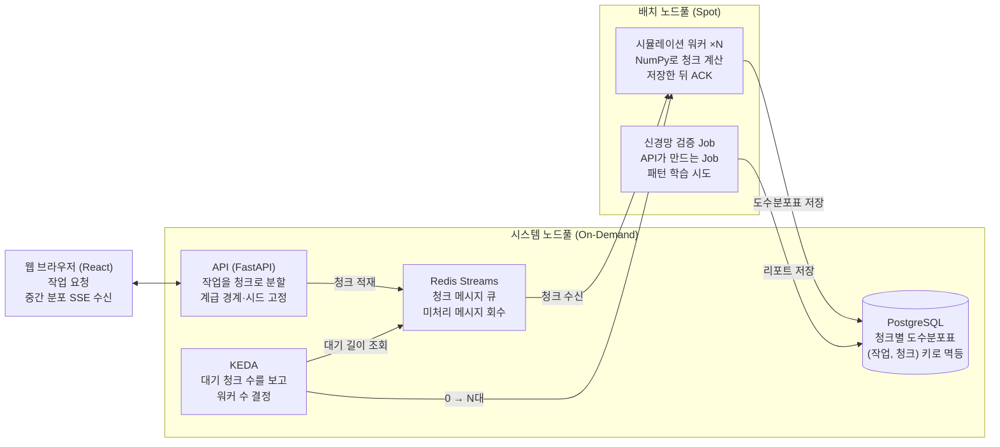

# 분산 몬테카를로 시뮬레이션 플랫폼 설계서

작성: 한승재 · 2026-11-17

> Phase 0 구현 중 설계에서 바뀐 4가지는 [README](../README.md#설계서와-달라진-점)에 정리했다.

## 개요

룰렛·바카라 베팅 전략을 수십억 판 규모로 시뮬레이션해 기댓값, 파산 확률, 최종 수익 도수분포표를 보여 주는 플랫폼이다. 계산 자체는 단순하므로, 이 프로젝트의 본체는 그 계산을 Kubernetes에서 빠르고 싸고 틀리지 않게 나눠 돌리는 배치 인프라다.

포트폴리오에서 증명할 역량은 네 가지다.

- 큐 길이에 따라 워커를 0대에서 N대로 늘리고 다시 0대로 줄이는 배치 확장 (KEDA, Karpenter)
- Spot 중단이 일어나도 결과가 유실·중복되지 않는 설계 (결정적 시드, 멱등 저장)
- 결과를 합칠 수 있는 도수분포표로 모아 분산 집계를 단순하게 만든 판단
- 처리량, 확장 시간, 작업당 비용을 숫자로 측정해 보여 주는 관측 체계

기존 두 프로젝트(EKS 대회 과제, RAG 챗봇)는 요청-응답 서비스라서, 큐 기반 배치 워크로드인 이 프로젝트와 겹치지 않는다. 외부에 보일 이름은 "확률 시뮬레이션 플랫폼"으로 하고, 도박은 하우스 엣지를 검증하는 데모 주제로 둔다.

## 요구사항과 목표 지표

핵심 목표는 1코어로 약 1시간 걸리는 기준 작업을 3분 안에, 결과 유실이나 중복 없이 끝내는 것이다. 기준 작업의 크기는 Phase 0에서 코어당 처리 속도를 잰 뒤 정한다.

### 기능 요구사항

- 게임: 유럽식 룰렛(37칸), 바카라(뱅커·플레이어·타이), 사용자 정의 주사위
- 전략: 고정 베팅, 마틴게일(테이블 한도 포함), 자금 비율 베팅, 손절·익절 조건
- 입력: 게임, 전략, 시작 자금, 판당 베팅액, 판 수, 도박사 수, 시드(선택)
- 출력: 최종 수익 도수분포표, 평균·표준편차, 파산 확률, 분위수(p5·p50·p95), 이론 기댓값과의 차이
- 실행 중에는 끝난 청크까지 합친 중간 분포를 SSE로 계속 보여 준다
- 신경망 검증 리포트 (신경망 검증 Job 절)

### 비기능 요구사항

| 항목 | 목표 | 측정 방법 |
| --- | --- | --- |
| 처리 시간 | 기준 작업(1코어 약 1시간)을 3분 안에 | 작업 생성부터 완료까지 시간 |
| 확장 시간 | 노드가 있으면 30초, 새 Spot 노드가 필요하면 2분 안에 첫 청크 시작 | 큐 적재 시각과 첫 청크 시작 시각의 차이 |
| 축소 | 큐가 빈 뒤 5분 안에 워커 0대, 빈 노드도 정리 | 워커 수·노드 수 메트릭 |
| 재현성 | 같은 파라미터와 시드면 같은 도수분포표 | 같은 작업 2회 실행 후 비교 |
| 내결함성 | 워커·노드가 중단돼도 유실·중복 0 | 중단 주입 후 청크 수와 합계 검증 |
| 정확성 | 고정 베팅 평균 수익이 이론 기댓값의 99% 신뢰구간 안 | 단위 테스트 |
| 비용 | 기준 작업 1회당 비용을 측정해 공개 | 노드 가동 시간 × Spot 단가 |
| 남용 방지 | 작업 크기 상한, IP당 요청 제한 | API 테스트 |

## 전체 아키텍처

워커만 Spot 노드풀에서 돌고, 나머지는 항상 켜져 있는 On-Demand 노드풀에 둔다. 워커와 API는 큐와 DB로만 연결된다.



워커가 늘면 Karpenter가 Spot 노드를 붙이고, 비면 정리한다. Phase 1(K3s)에서는 노드풀 구분 없이 같은 구조로 돈다. 관측(Prometheus·Grafana)은 모든 구성요소에서 메트릭을 수집하며 "관측과 장애 대응"에서 다룬다.

### 요청부터 결과까지

1. 사용자가 게임·전략·규모를 보내면 API가 계급 경계와 시드를 정하고, 작업을 청크로 나눠 Redis Streams에 넣는다.
2. KEDA가 대기 청크 수를 보고 워커를 0대에서 N대로 늘린다. 노드가 모자라면 Karpenter가 Spot 노드를 추가한다.
3. 워커는 청크를 계산해 도수분포표를 PostgreSQL에 저장한 뒤 ACK한다.
4. 워커가 완료 이벤트를 Redis Pub/Sub으로 알리면, API가 지금까지의 도수분포표를 합쳐 SSE로 보낸다.
5. 큐가 비면 워커는 0대로 줄고, 빈 노드는 Karpenter가 정리한다.

## 컴포넌트 상세

워커는 큐와 DB만 알고 API를 호출하지 않는다. 그래서 워커를 몇 대로 늘리든 API는 영향을 받지 않는다.

| 컴포넌트 | 역할 | 기술 | 위치 |
| --- | --- | --- | --- |
| 웹 | 입력 폼, 도수분포표·히스토그램, 진행률 | React | 시스템 노드풀 |
| API | 작업 검증, 계급 경계·시드 결정, 청크 분할, 결과 합산, SSE | FastAPI | 시스템 노드풀 |
| 큐 | 청크 메시지 전달, 미처리 메시지 재배달 | Redis Streams (consumer group) | 시스템 노드풀 |
| 시뮬레이션 워커 | 청크 계산, 도수분포표와 요약 통계 저장 | Python, NumPy | 배치 노드풀 (Spot) |
| 저장소 | 작업, 청크 결과, 검증 리포트 | PostgreSQL | 시스템 노드풀 |
| 스케일러 | 대기 청크 수로 워커 수 결정 | KEDA | 시스템 노드풀 |
| 노드 관리 | 워커 수에 맞춰 Spot 노드 추가·정리 | Karpenter (Phase 2) | 시스템 노드풀 |
| 신경망 검증 | 패턴 학습 시도, 리포트 저장 | Kubernetes Job, PyTorch(CPU) | 배치 노드풀 (Spot) |
| 관측 | 메트릭·로그·대시보드 | VictoriaMetrics 또는 Prometheus, Grafana, Loki | 시스템 노드풀 |

### 워커 처리 순서

1. `XREADGROUP`으로 청크 메시지 1개를 받는다.
2. (작업 시드, 청크 번호)로 난수 생성기를 만든다.
3. 청크의 도박사 수 × 판 수를 NumPy 벡터 연산으로 계산한다. 도박사를 배열로 두고 한 판씩 동시에 진행한다.
4. 결과를 `INSERT … ON CONFLICT DO NOTHING`으로 저장한다.
5. `XACK`로 메시지를 끝내고, Redis Pub/Sub으로 완료 이벤트를 알린다.

저장한 뒤에 ACK하므로, ACK 전에 워커가 죽어도 메시지는 남고 재처리될 뿐 유실되지 않는다.

### 그 밖의 동작

- 미처리 메시지 회수: 워커는 주기적으로 `XAUTOCLAIM`을 호출해, 청크 처리 시간의 3배 넘게 ACK되지 않은 메시지를 가져온다.
- 종료 처리: SIGTERM을 받으면 새 메시지를 받지 않고 처리 중인 청크만 끝낸다. `terminationGracePeriodSeconds`는 90초로, Spot 중단 예고(2분) 안에 끝난다.
- 작업 완료: 저장된 청크 수가 전체 청크 수와 같아지면 API가 작업을 `done`으로 바꾼다.
- 중간 결과: API는 Pub/Sub 이벤트를 받을 때마다 DB에서 합산해 SSE로 보낸다. 이벤트를 놓쳐도 다음 조회가 DB 기준으로 맞춘다.

## 데이터 모델과 API

결과는 청크마다 한 행씩 저장하고, 작업 결과는 그 행들을 더해서 만든다. `chunk_results`의 기본 키 (job_id, chunk_index)가 중복 저장을 막는 장치다.

```sql
CREATE TABLE simulation_jobs (
  id          uuid PRIMARY KEY,
  params      jsonb    NOT NULL,   -- 게임, 전략, 자금, 판 수, 도박사 수
  seed        bigint   NOT NULL,
  bin_edges   bigint[] NOT NULL,   -- 계급 경계(칩), 작업 생성 시 고정
  n_chunks    int      NOT NULL,
  status      text     NOT NULL,   -- queued, running, done, failed
  created_at  timestamptz NOT NULL DEFAULT now(),
  finished_at timestamptz
);

CREATE TABLE chunk_results (
  job_id      uuid REFERENCES simulation_jobs(id),
  chunk_index int,
  counts      bigint[] NOT NULL,   -- 계급별 도수, 양 끝에 아래·위 넘침 계급
  n           bigint   NOT NULL,   -- 도박사 수
  sum_profit  bigint   NOT NULL,
  sum_sq      numeric  NOT NULL,   -- 수익 제곱합, 정수라 오차 없음
  min_profit  bigint   NOT NULL,
  max_profit  bigint   NOT NULL,
  ruined      bigint   NOT NULL,   -- 파산한 도박사 수
  duration_ms int      NOT NULL,
  worker      text     NOT NULL,   -- 파드 이름
  PRIMARY KEY (job_id, chunk_index)
);

CREATE TABLE ai_checks (
  id           uuid PRIMARY KEY,
  job_id       uuid REFERENCES simulation_jobs(id),
  params       jsonb NOT NULL,     -- 모델 구조, 데이터 크기, 대조 실험 여부
  train_loss   float8,
  holdout_loss float8,
  entropy      float8,
  accuracy     float8,
  status       text NOT NULL,
  created_at   timestamptz NOT NULL DEFAULT now()
);
```

| 메서드 | 경로 | 하는 일 |
| --- | --- | --- |
| POST | `/simulations` | 크기 검증, 계급 경계·시드 결정, 청크 적재 후 `202`와 작업 ID 반환 |
| GET | `/simulations/{id}` | 상태, 진행률, 지금까지 합친 도수분포표와 통계 |
| GET | `/simulations/{id}/events` | SSE. 청크가 끝날 때마다 진행률과 중간 분포 |
| POST | `/simulations/{id}/ai-checks` | 신경망 검증 Job 생성 |
| GET | `/ai-checks/{id}` | 검증 리포트 |
| GET | `/presets` | 게임·전략 프리셋 |
| GET | `/metrics` | Prometheus 메트릭 |

## 핵심 설계 결정

결정적 시드, 멱등 저장, 합칠 수 있는 도수분포표를 묶으면 "최소 한 번 전달"되는 큐 위에서도 결과가 정확히 한 번씩만 집계된다. 아래 여섯 가지가 그 장치다.

### 결과는 도수분포표로만 모은다

청크는 도박사별 원본 결과 대신 계급별 도수와 합계·제곱합·최솟값·최댓값·파산 수만 저장한다. 합치기는 같은 계급끼리 더하기라서, 청크가 어떤 순서로 끝나든 몇 개만 끝났든 같은 규칙으로 집계된다. 전송량은 판 수와 상관없이 청크당 수 KB다.

```math
\bar{x} = \frac{\sum_c S_c}{\sum_c n_c}, \qquad s^2 = \frac{\sum_c Q_c}{\sum_c n_c} - \bar{x}^2
```

S_c는 청크 c의 수익 합, Q_c는 수익 제곱합, n_c는 도박사 수다. 평균과 분산은 정확하고, 분위수는 도수분포표를 보간한 근사값이다. Prometheus 히스토그램도 같은 원리다. `le` 버킷이 누적도수이고, `histogram_quantile`이 도수분포표 보간이다.

### 계급 경계는 작업을 만들 때 고정한다

워커마다 경계가 다르면 도수분포표를 합칠 수 없다. 고정 베팅은 이론 평균 ± 6σ로 범위를 잡고, 마틴게일처럼 이론값이 없는 전략은 API가 도박사 1만 명 파일럿 실행으로 정한다. 양 끝에 아래·위 넘침 계급을 두어 범위 밖 값도 버리지 않는다.

계급은 약 200개로 저장하고, 화면에서는 저장 계급 폭의 배수로 다시 묶어 보여 준다.

### 시드는 (작업 시드, 청크 번호)로 정한다

`np.random.SeedSequence(entropy=작업 시드, spawn_key=(청크 번호,))`로 청크마다 독립적이면서 결정적인 난수열을 만든다. 같은 청크를 다시 계산해도 결과가 같아서 재시도가 안전하고, 작업 전체를 재현할 수 있다.

시간이나 파드 이름으로 시드를 잡으면 재시도 결과가 달라지고, 같은 시각에 뜬 파드끼리 난수열이 겹칠 수 있다.

### 저장은 멱등하게, ACK는 저장 뒤에

기본 키 (job_id, chunk_index)와 `ON CONFLICT DO NOTHING`으로, 같은 청크가 두 번 처리돼도 한 번만 들어간다. 저장 전에 죽으면 메시지가 남아 다른 워커가 회수하고, 저장 뒤 ACK 전에 죽으면 재계산 결과가 같아서 충돌만 무시된다.

즉 최소 한 번 전달과 멱등 저장을 합쳐 정확히 한 번 집계를 얻는다. 막은 중복 횟수는 메트릭으로 남겨 실제로 몇 번 막았는지 보여 준다.

### 청크 크기는 처리 시간 20~30초에 맞춘다

너무 작으면 큐·DB 오버헤드가 커지고, 너무 크면 Spot 중단 때 버리는 계산이 늘고 확장 효과가 줄어든다. 기준은 SIGTERM 뒤 유예 시간(90초) 안에 처리 중인 청크를 끝낼 수 있어야 한다는 것이다.

```math
\text{청크당 도박사 수} = \frac{\text{목표 시간(초)} \times \text{코어당 처리 속도(판/초)}}{\text{도박사 1명의 판 수}}
```

### 기준 작업은 마틴게일로 정한다

중단 조건이 없는 고정 베팅은 도박사마다 이항분포 한 번으로 계산이 끝나 나눠 돌릴 이유가 없다. 판마다 베팅액이 바뀌고 파산이 생기는 마틴게일은 판 단위 계산이 필요해 실제로 무겁다.

## 확장과 비용

KEDA가 대기 청크 수로 워커 파드 수를, Karpenter가 그 파드를 올릴 Spot 노드 수를 정한다. 비용 상한은 NodePool의 `limits.cpu`가 강제한다.

### KEDA: 워커 수

워커는 ScaledJob이 아니라 ScaledObject(Deployment)로 돌린다. 청크가 짧고 많아서 청크마다 파드를 띄우면 이미지 pull과 Python 시작 시간이 계산 시간보다 커진다. ScaledJob은 한 번 길게 도는 신경망 검증에만 쓴다.

```yaml
apiVersion: keda.sh/v1alpha1
kind: ScaledObject
metadata:
  name: sim-worker
spec:
  scaleTargetRef:
    name: sim-worker
  minReplicaCount: 0
  maxReplicaCount: 50          # Phase 1(K3s)은 4
  pollingInterval: 5
  cooldownPeriod: 120
  triggers:
    - type: redis-streams
      metadata:
        address: redis.sim.svc:6379
        stream: sim:chunks
        consumerGroup: workers
        lagCount: "4"            # 워커 1대당 대기 청크 4개
        activationLagCount: "0"
```

- `lagCount`는 Redis 7 이상이 필요하다.
- 마지막 청크들이 처리 중일 때 lag이 0이 되므로, 축소는 `cooldownPeriod` 뒤에 일어난다. 그래도 죽는 파드는 SIGTERM 처리로 청크를 끝내거나 메시지를 남긴다.
- 워커 파드는 CPU 1, 메모리 512Mi를 요청한다. Phase 0 측정 후 조정한다.

### Karpenter: Spot 노드 (Phase 2)

```yaml
apiVersion: karpenter.sh/v1
kind: NodePool
metadata:
  name: batch-spot
spec:
  template:
    spec:
      requirements:
        - key: karpenter.sh/capacity-type
          operator: In
          values: ["spot"]
        - key: karpenter.k8s.aws/instance-category
          operator: In
          values: ["c"]
        - key: karpenter.k8s.aws/instance-generation
          operator: Gt
          values: ["5"]
      taints:
        - key: workload
          value: batch
          effect: NoSchedule
      nodeClassRef:
        group: karpenter.k8s.aws
        kind: EC2NodeClass
        name: default
  limits:
    cpu: "64"                  # 비용 상한
  disruption:
    consolidationPolicy: WhenEmptyOrUnderutilized
    consolidateAfter: 30s
```

- 컴퓨팅 최적화 계열을 여러 세대·크기로 허용해 Spot 용량을 확보할 확률을 높인다.
- taint를 허용하는 워커·신경망 Job만 이 노드에 올라간다. API·Redis·PostgreSQL·관측은 On-Demand 시스템 노드풀에 둔다.
- Karpenter 중단 큐(SQS)를 연결해, Spot 중단 예고가 오면 노드를 미리 비우게 한다.

### 비용 통제

- EKS 컨트롤 플레인은 클러스터가 켜져 있는 동안 시간당 0.10달러가 나간다. Terraform으로 실험할 때만 만들고 끝나면 `destroy`한다.
- NAT 게이트웨이도 시간당 과금이다. 실험 시간에만 유지한다.
- AWS Budgets로 월 예산 알림을 건다.
- 작업당 비용 = 작업 동안 배치 노드의 가동 시간 × 그 시점 Spot 단가. 노드 생성·삭제 시각을 기록해 계산하거나 OpenCost를 쓴다.
- Phase 1(기존 K3s 2대)은 추가 비용이 없다.

## 관측과 장애 대응

포트폴리오의 증거는 대시보드 사진 세 장이다. 대기 청크가 쌓이면 워커가 따라 늘고, 중단이 있어도 중복·유실이 0이며, 작업이 끝나면 노드가 0대로 돌아오는 장면이다.

### 메트릭

| 메트릭 | 종류 | 용도 |
| --- | --- | --- |
| `sim_chunk_duration_seconds` | histogram | 청크 처리 시간 분포, 청크 크기 조정 근거 |
| `sim_rounds_total` | counter | 초당 처리 판 수(처리량) |
| `sim_chunks_completed_total` | counter | 진행률, 처리 속도 |
| `sim_chunk_duplicates_total` | counter | `ON CONFLICT`로 막은 중복 저장 수 |
| `sim_chunk_reclaimed_total` | counter | `XAUTOCLAIM`으로 회수한 메시지 수 |
| `sim_job_duration_seconds` | histogram | 작업 생성부터 완료까지 |
| 대기 청크 수(lag) | gauge | KEDA가 보는 것과 같은 값 |
| 워커 수, 용량 유형별 노드 수 | gauge | kube-state-metrics, Karpenter 메트릭 |

### 대시보드와 알림

- 작업 진행: 대기 청크 수, 워커 수, 처리량, 청크 처리 시간을 한 화면에. 확장이 대기열을 따라가는지 보인다.
- 노드와 비용: Spot·On-Demand 노드 수, 노드 가동 시간, 작업당 비용.
- 정확성: 중복 차단, 회수, 실패 청크 수.
- 알림: 대기 청크가 있는데 워커가 0대인 상태가 3분 계속(스케일러 고장), 청크 실패율 5% 초과, 작업이 예상 시간의 3배 넘게 running.

### 장애 시나리오

| 상황 | 생기는 일 | 대응 | 검증 방법 |
| --- | --- | --- | --- |
| Spot 중단 | 2분 뒤 노드 회수 | Karpenter가 노드를 비우고, 워커는 처리 중인 청크만 끝내고 종료. 못 끝낸 메시지는 회수 | AWS FIS로 Spot 중단 주입 |
| 워커 강제 종료(OOM 등) | ACK 안 된 메시지가 남음 | 다른 워커가 `XAUTOCLAIM`으로 회수, 시드가 같아 결과도 같음 | `kubectl delete pod --grace-period=0` |
| 저장 뒤 ACK 전 종료 | 같은 청크 재처리 | `ON CONFLICT`로 무시 | 중복 차단 메트릭 확인 |
| 계속 실패하는 청크(버그) | 무한 재시도 | 배달 3회를 넘기면 dead-letter 스트림으로 옮기고 작업을 `failed`로 | 일부러 예외를 던지는 청크 |
| PostgreSQL 일시 장애 | 저장 실패 | 재시도 후에도 실패하면 ACK하지 않아 나중에 회수 | DB 파드 재시작 |
| 워커 급증으로 DB 커넥션 증가 | `max_connections` 근접 | 워커당 커넥션 1개, 최대 워커 수보다 여유 있게 설정. 부족하면 PgBouncer | 최대 확장 상태에서 커넥션 수 확인 |
| Redis 재시작 | 큐 유실 가능 | AOF 영속화. 유실되면 API가 DB에 없는 청크만 다시 적재 | Redis 파드 재시작 |

DB 커넥션 항목은 대회 과제에서 RDS Proxy로 풀었던 문제와 같은 구조라, 두 프로젝트를 이어서 설명할 수 있다.

## 신경망 검증 Job

직전 결과들로 다음 결과를 맞히도록 신경망을 학습시켜도, 검증 손실이 엔트로피 아래로 내려가지 않는다는 것을 보여 주는 Job이다. 결함 있는 룰렛으로 대조 실험을 함께 돌려, 모델이 무능해서가 아니라 패턴이 없어서라는 것을 증명한다.

### 설계

- 데이터: 같은 시드 방식으로 만든 룰렛 결과열 1,000만 판. 앞 80%는 학습, 뒤 20%는 검증.
- 모델: 입력은 직전 16판(원-핫), 출력은 다음 칸 37개의 확률(소프트맥스). 은닉층 2개 MLP, 교차 엔트로피 손실. CPU로 충분하다.
- 실행: API가 네임스페이스 한정 권한(Job 생성만)을 가진 ServiceAccount로 Kubernetes Job을 만든다. 결과는 `ai_checks`에 저장한다.

### 판정 기준

| 지표 | 공정한 룰렛에서 기대값 | 결함 룰렛(대조군)에서 기대값 |
| --- | --- | --- |
| 검증 손실 | 엔트로피 ln 37 ≈ 3.611 근처, 그 아래로 못 내려감 | 엔트로피보다 뚜렷하게 낮음 |
| 정확도 | 1/37 ≈ 2.7% 근처 | 2.7%보다 높음 |
| 학습 손실 | 엔트로피 아래로 내려갈 수 있음(과적합) | 검증 손실과 함께 내려감 |

대조군은 직전 칸의 이웃 칸이 나올 확률을 높인 룰렛이다. 리포트 화면에는 두 실험의 학습·검증 손실 곡선을 엔트로피 점선과 함께 그린다.

## 단계별 로드맵과 검증 계획

전체 6~7주를 다섯 단계로 나누고, 각 단계는 통과 기준을 넘어야 다음으로 간다. Phase 1까지는 추가 비용이 없고, 비용은 Phase 2부터 든다. 핵심 증명은 Phase 2의 Spot 확장이다.

| 단계 | 기간 | 할 일 | 통과 기준 | 상태 |
| --- | --- | --- | --- | --- |
| Phase 0 · 엔진 | 1주 | NumPy 시뮬레이터, 정확성 테스트, 처리 속도 측정 | 이론값과 일치, 같은 시드 = 같은 결과 | 완료 ([README](../README.md)) |
| Phase 1 · K3s | 1~2주 | 기존 K3s 2대에 Redis·KEDA·워커, 중단 주입 시험 | 0 → N → 0 동작, 유실·중복 0 | |
| **Phase 2 · EKS** | 2주 | Terraform으로 EKS·Spot 구축, FIS 중단 시험 | **기준 작업 3분 안**, Spot 중단에도 정확 | |
| Phase 3 · AI | 1주 | 신경망 검증 Job, 대조 실험, 리포트 화면 | 검증 손실 ≥ 엔트로피, 대조군은 패턴 발견 | |
| Phase 4 · 마무리 | 1주 | k6 부하 시험, 대시보드 캡처, 포트폴리오 정리 | 숫자 3개 확보 (처리량·확장·비용) | |

### 테스트

- 정확성: 유럽식 룰렛 단일 숫자 고정 베팅의 평균 수익이 이론 기댓값(판당 −1/37 ≈ −2.7%)의 99% 신뢰구간 안에 든다.
- 합치기: 청크 결과를 어떤 순서로 합쳐도 같고, 원본 값을 모아 직접 만든 도수분포표와 같다.
- 재현성: 같은 작업을 두 번 돌리면 도수분포표가 바이트 단위로 같다.
- 멱등성: 같은 청크 메시지를 일부러 두 번 넣어도 합계는 변하지 않고, 중복 차단 메트릭만 1 오른다.
- 중단: Phase 1은 `kubectl delete pod --grace-period=0`, Phase 2는 AWS FIS Spot 중단으로 시험하고 청크 수와 합계를 검증한다.
- 부하: k6로 작업 생성 API를 동시에 호출해 처리량과 요청 제한 동작을 확인한다.

## 리스크와 열린 질문

가장 큰 리스크는 계산이 너무 가벼워 분산한 효과가 숫자로 안 보이는 것이다. 그래서 기준 작업을 마틴게일로 정하고, 크기는 Phase 0 측정으로 맞춘다.

| 리스크 | 대응 |
| --- | --- |
| 계산이 가벼워 분산 효과가 안 보임 | 마틴게일 기준 작업, 1코어 약 1시간 크기로 조정 |
| 특정 시간대 Spot 용량 부족 | 인스턴스 계열·크기 다양화, 가중치가 낮은 On-Demand 대체 NodePool |
| 비용 초과 | `limits.cpu`, 예산 알림, 실험 후 `terraform destroy`, 작업 크기 상한 |
| NumPy 성능 한계 | 핵심 루프만 Numba나 Go로 교체. 경계가 큐 메시지와 DB 행이라 교체가 쉽다 |
| "도박" 주제의 인상 | 공개 이름은 확률 시뮬레이션 플랫폼, 하우스 엣지 검증을 전면에 |

### 열린 질문

- [ ] 월 AWS 예산 상한을 얼마로 할까?
- [ ] Phase 2를 EKS로 갈지, 비용 때문에 K3s에서 끝낼지?
- [ ] AWS에서는 큐를 SQS로 바꿀까? AWS 경험은 늘지만 K3s와 공통 구조는 사라진다.
- [ ] 메트릭 저장소는 RAG 프로젝트처럼 VictoriaMetrics로 할까, Prometheus로 할까?
- [ ] 워커 언어는 Python으로 충분한가? Phase 0 측정 후 결정한다.
